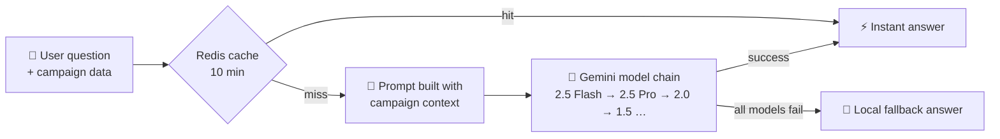
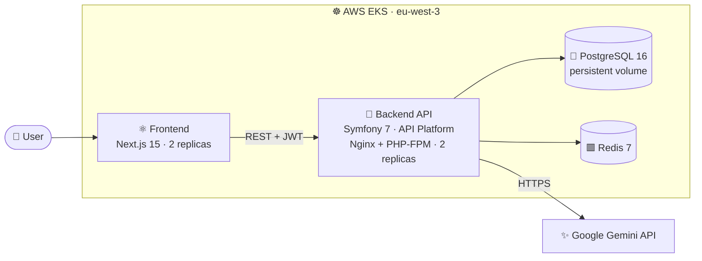
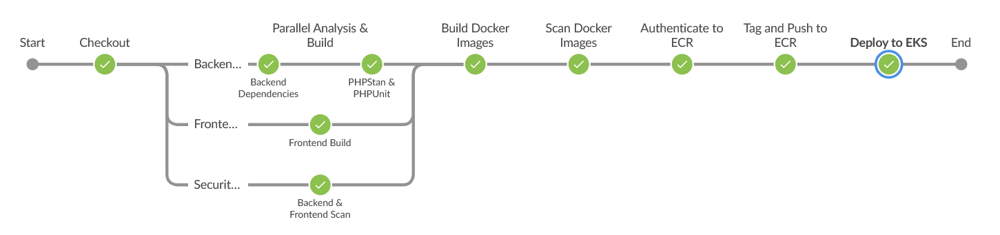
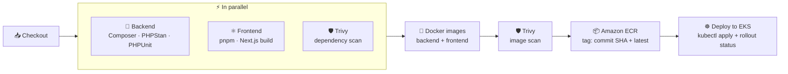
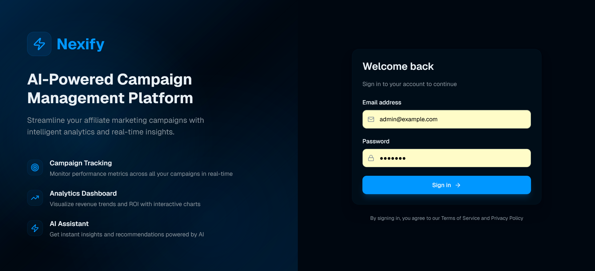

<div align="center">

# 🚀 Nexify — AI-Powered Marketing Campaign Platform

**Next.js 15 · Symfony 7 / API Platform · Google Gemini · Docker · Jenkins · AWS EKS**

[](#-tech-stack)
[](#-tech-stack)
[](#-tech-stack)
[](#-tech-stack)
[](#-tech-stack)
[](#-ai-assistant)
<br/>
[](#-tech-stack)
[](#-tech-stack)
[](#-run-it-locally)
[](#-cicd-pipeline)
[](#-deployment-on-aws-eks)
[](#-cicd-pipeline)

[Features](#-features) • [AI assistant](#-ai-assistant) • [Architecture](#-architecture) • [CI/CD](#-cicd-pipeline) • [AWS EKS](#-deployment-on-aws-eks) • [Screenshots](#-screenshots) • [Run it](#-run-it-locally)

<br/>


</div>

---

## 💡 What is it?

**Nexify** helps marketing teams follow their campaigns in one place: budget, revenue, ROI, conversions and affiliates. It also includes an **AI assistant** you can question in plain language.

The project covers the whole chain, from code to cloud:

- a **Next.js 15 / React 19** front end;
- a **Symfony 7 / API Platform** REST API secured with **JWT**;
- an AI assistant built on **Google Gemini**, with a **Redis** cache;
- a **Jenkins** pipeline with parallel quality checks and **Trivy** security scans;
- deployment on **AWS EKS**, with images stored in **Amazon ECR**.

---

## ✨ Features

| | |
|---|---|
| 📊 **Dashboard** | Total revenue, active campaigns, affiliates, conversions and conversion rate, with revenue and performance trend charts |
| 📋 **Campaigns** | Create, edit and search campaigns; follow budget, revenue and ROI for each one |
| 👥 **Affiliates** | Manage affiliate partners and link them to campaigns |
| 🤖 **AI assistant** | Ask questions about your campaigns in natural language, from any page (floating chat) |
| 🔐 **Authentication** | JWT login (LexikJWTAuthenticationBundle) and protected routes on the front end |
| 📚 **Self-documented API** | OpenAPI documentation generated by API Platform |

---

## 🤖 AI assistant

The assistant is not a simple API call: it is built to stay **useful, fast and available**.



- **Context-aware**: the campaign's data is injected into the prompt, so answers are based on real figures.
- **Resilient**: the service lists the Gemini models available to the API key, then tries them in order of preference until one answers.
- **Fast and cheaper**: identical questions are served from **Redis** for 10 minutes.
- **Never broken**: if Gemini cannot be reached, the assistant still returns a fallback answer instead of an error.
- **Tested**: covered by PHPUnit unit tests.

---

## 🏗 Architecture



- **Separate services**: the front end and the back end are deployed and scaled independently.
- **API-first**: entities exposed by API Platform, with search filters and OpenAPI docs.
- **Versioned schema**: database changes are managed with Doctrine migrations.
- **Production-ready pods**: liveness and readiness probes, CPU and memory requests and limits.

---

## 🔄 CI/CD pipeline

A **Jenkins** pipeline takes every change from commit to production on EKS:





- **Parallel stages**: back-end checks, front-end build and security scans run at the same time.
- **Quality**: PHPStan static analysis and PHPUnit tests, with JUnit reports published in Jenkins.
- **Security**: Trivy scans the dependencies and then the final Docker images, and the reports are archived with each build.
- **Traceability**: every image is tagged with its **commit SHA**, so you can roll back to any version.
- **Safe rollout**: the pipeline waits for `kubectl rollout status` before reporting a successful deployment.

---

## ☸️ Deployment on AWS EKS

The cluster is described in `k8s/eks-cluster.yaml` and created with **eksctl**:

- region **eu-west-3 (Paris)**, Kubernetes **1.32**, spread over 3 availability zones;
- managed node group of **t3.medium** instances, **2 to 4 nodes**, tagged for the Cluster Autoscaler;
- IAM add-on policies for autoscaling, EBS volumes and load balancers.

The application manifests are applied in order:

| Manifest | Content |
|---|---|
| `00-namespace.yaml` | `nexify` namespace |
| `01-configmap.yaml` | Application configuration |
| `02-secrets.yaml` | Application secrets |
| `03-postgres.yaml` | PostgreSQL 16 with a persistent volume |
| `04-redis.yaml` | Redis cache |
| `05-backend.yaml` | Symfony API, 2 replicas, LoadBalancer service |
| `06-frontend.yaml` | Next.js, 2 replicas, LoadBalancer service |

---

## 📸 Screenshots

<table>
<tr>
<td width="50%"><b>🔐 Login</b><br/></td>
<td width="50%"><b>📊 Dashboard</b><br/></td>
</tr>
<tr>
<td width="50%"><b>📋 Campaign performance</b><br/></td>
<td width="50%"><b>🎯 Campaign details</b><br/></td>
</tr>
<tr>
<td width="50%"><b>🤖 AI assistant</b><br/></td>
<td width="50%"><b>👥 Affiliates</b><br/></td>
</tr>
</table>

---

## 🚀 Run it locally

**Prerequisites:** Docker and Docker Compose.

```bash
git clone https://github.com/ouchajaaamine/Nexify.git
cd Nexify

# Optional: enables the AI assistant
echo "GOOGLE_API_KEY=your_key_here" > .env

docker compose up -d --build
docker compose exec app composer install
docker compose exec app php bin/console doctrine:migrations:migrate
docker compose exec app php bin/console doctrine:fixtures:load   # sample data
```

| Service | URL |
|---|---|
| Frontend | http://localhost:3000 |
| API | http://localhost:8000 |
| API documentation | http://localhost:8000/api |

> Without `GOOGLE_API_KEY` the application works normally, and the assistant answers in fallback mode. You can get a free key from [Google AI Studio](https://aistudio.google.com/).

---

## 🧰 Tech stack

| Layer | Technologies |
|---|---|
| **Frontend** | Next.js 15 (App Router), React 19, TypeScript, Tailwind CSS 4, shadcn/ui, Recharts |
| **Backend** | PHP 8.2+, Symfony 7.3, API Platform 4, Doctrine ORM 3, LexikJWTAuthenticationBundle |
| **Data** | PostgreSQL 16, Redis 7 |
| **AI** | Google Gemini API, with model fallback and response caching |
| **Quality** | PHPUnit, PHPStan |
| **Security** | Trivy (dependencies and images), JWT |
| **Containers** | Docker (multi-stage builds), Nginx + PHP-FPM with Supervisor |
| **CI/CD** | Jenkins (declarative pipeline, parallel stages) |
| **Cloud** | AWS EKS (eksctl), Amazon ECR, Elastic Load Balancing |

---

## 📂 Project structure

```
Nexify/
├── backend/              # Symfony 7 + API Platform
│   ├── src/
│   │   ├── Entity/       # Campaign, Affiliate, Metric, User
│   │   ├── ApiResource/  # Login and Chatbot endpoints
│   │   ├── Service/      # ChatbotService (Gemini + cache + fallback)
│   │   └── State/        # API Platform processors
│   ├── migrations/       # Doctrine migrations
│   └── tests/            # PHPUnit tests
├── frontend/             # Next.js 15 (App Router)
│   ├── app/dashboard/    # Dashboard, campaigns, affiliates, chat
│   └── components/       # UI, charts, AI chat
├── k8s/                  # EKS cluster + Kubernetes manifests
├── jenkins/              # Jenkins image and setup
├── Jenkinsfile           # CI/CD pipeline
└── docker-compose.yml    # Local environment
```

---

## 🛣 Roadmap

- [ ] Horizontal Pod Autoscaler on the API and the front end
- [ ] Make the Trivy scans blocking on CRITICAL vulnerabilities
- [ ] Manage secrets with AWS Secrets Manager
- [ ] End-to-end tests (Playwright) in the pipeline

---

<div align="center">

### 👋 Author

**Amine Ouchajaa**, Software Engineer (Full Stack · DevOps)

[](https://linkedin.com/in/amine-ouchajaa)
[](https://github.com/ouchajaaamine)

⭐ If you like this project, a star is always appreciated!

</div>
